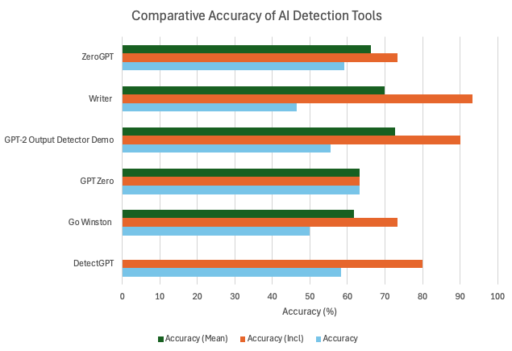
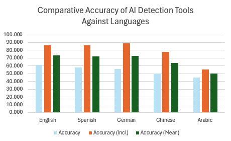
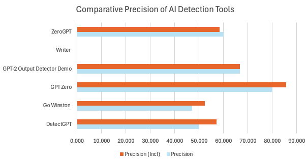
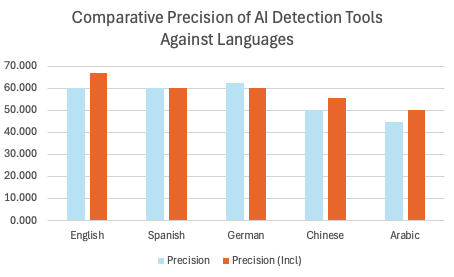

# Multilingual AI Text Detection (2024) – Angus Fotheringham

An evaluation of AI-generated text detection tools across five languages: English, Spanish, German, Chinese and Arabic.

## Overview

As generative AI becomes more widely used in education and other settings, reliably distinguishing AI-generated text from human-written text has become increasingly important. However, AI text detection tools may perform differently across languages, raising questions about their reliability in multilingual contexts.

This research evaluates the effectiveness of six AI text detection tools in distinguishing human-written and AI-generated text across five languages. It investigates whether detection performance varies between languages and considers the implications for academic integrity and the responsible use of AI detection technologies.

## Research Objectives

- Evaluate the performance of existing AI text detection tools across multiple languages.
- Compare detection performance between English and four other languages.
- Investigate differences in detector accuracy and classification outcomes.
- Consider the limitations of current detection methods and their implications for multilingual users.
- Identify potential directions for improving multilingual AI text detection.

## Languages Evaluated

| Language | Script |
|---|---|
| English | Latin script |
| German | Latin script |
| Spanish | Latin script |
| Chinese | Chinese characters (Hanzi) |
| Arabic | Arabic script |

The script classifications provide context for comparing results; they do not, by themselves, establish why a detector performs differently in a particular language.

## Methodology

### Dataset

The research uses the XQuAD dataset as the source of text material. The study examines human-written text alongside AI-generated text produced using GPT-4, using corresponding topics to support comparison.

The evaluation covers five languages and considers the ability of existing detection tools to distinguish between human-written and AI-generated content.

### Detection Tools

The six tools evaluated are:

- DetectGPT
- Go Winston
- GPTZero
- GPT-2 Output Detector Demo
- Writer.AI
- ZeroGPT

### Evaluation Metrics

Detector outputs are assessed by comparing their classifications against the known origin of the text.

The research considers two accuracy measures:

- **Regular accuracy:** evaluates classifications that produce a definite decision.
- **Inclusive accuracy:** incorporates selected uncertain classifications according to the study's evaluation method.

The study also evaluates precision using regular and inclusive precision measures.

These metrics should be interpreted separately, as they represent different aspects of detector performance.

## Results and Visualisations

The experimental results are provided as CSV files in the `results/` directory.

### Accuracy

The accuracy results compare the performance of the six detection tools and examine differences across the five languages.

**Detector accuracy**



**Language accuracy**



### Precision

Precision measures the proportion of positive classifications that were correctly classified.

**Detector precision**



**Language precision**



### Results Data

The underlying experimental results are available here:

- [Detector accuracy results](results/detector_results.csv)
- [Detector precision results](results/detector_precision_results.csv)

Both datasets include regular and inclusive evaluation measures.

## Key Findings

The results indicate that detector performance varies across tools and languages.

Key findings reported in the paper include:

- **Performance varies between tools.** GPT-2 Output Detector Demo achieved the highest reported average regular accuracy, at 72.778%, while Go Winston recorded the lowest, at 61.667%.
- **Performance varies across languages.** Detection accuracy was not consistent across all five languages, with the paper reporting particularly substantial decreases for Chinese and Arabic relative to English.
- **Detection remains imperfect.** The results demonstrate that detector classifications cannot be treated as definitive evidence of whether a text was generated by AI.
- **Evaluation methodology matters.** Regular and inclusive accuracy provide different perspectives on detector performance, making it important to explain how uncertain classifications are handled.
- **Precision also varies.** The results demonstrate differences in the proportion of positive classifications that were correct across the evaluated tools and languages.

These findings apply to the study's experimental setup and should not be interpreted as definitive rankings of detector performance across all possible texts, languages or AI models.

## Implications

The findings highlight several considerations for the use of AI text detection:

- **Academic integrity:** AI detector results should be interpreted cautiously rather than used as conclusive evidence of academic misconduct.
- **Multilingual fairness:** Tools evaluated primarily on English-language content may not perform equally well across other languages.
- **Responsible AI:** Evaluation methods should account for uncertainty, language variation and the consequences of incorrect classifications.
- **Further research:** Larger and more diverse datasets are needed to establish how well detection tools generalise to different writing styles, topics and language contexts.

## Limitations

The results must be considered in light of the study's experimental design.

- The evaluation uses a selected set of texts rather than an exhaustive representation of human and AI-generated writing.
- AI-generated content is produced using GPT-4; results may differ for other models and model versions.
- Detector performance may be affected by topic, writing style, dataset composition and the tools' underlying methodologies.
- Results from this experiment cannot establish that language characteristics alone caused observed differences in accuracy.
- AI detection tools change over time, so the findings represent an evaluation of the tools under the conditions of the study rather than a permanent assessment of their capabilities.

## Future Work

Potential extensions include:

- Evaluating additional languages and larger datasets.
- Comparing outputs from multiple generative AI models.
- Testing how paraphrasing, translation and changes in writing style affect detection performance.
- Examining false-positive and false-negative rates in greater detail.
- Investigating confidence thresholds and methods for handling uncertain classifications.
- Developing more robust evaluation frameworks for multilingual AI detection.

## Research Paper

The full research paper is available in the [`paper/`](paper/) directory.

**Title:** *Detecting Machine-Generated Text: How Effective are Current AI-Detection Methods for Non-English Text?*

**Author:** Angus Fotheringham

**Research context:** COMP SCI 2008

**Supervisor:** Dr Lia Song

## Repository Structure

```text
Multilingual-AI-Text-Detection/
├── README.md
├── paper/
│   └── research_paper.pdf
├── results/
│   ├── detector_results.csv
│   └── detector_precision_results.csv
└── figures/
    ├── detector_accuracy.png
    ├── language_accuracy.png
    ├── detector_precision.png
    └── language_precision.png
```

## Acknowledgements

This research was completed as part of COMP SCI 2008 at the University of Adelaide.

## Disclaimer

This project evaluates AI text detection tools for research and educational purposes. Its findings should not be used as the sole basis for decisions about academic misconduct or the authorship of a text.
